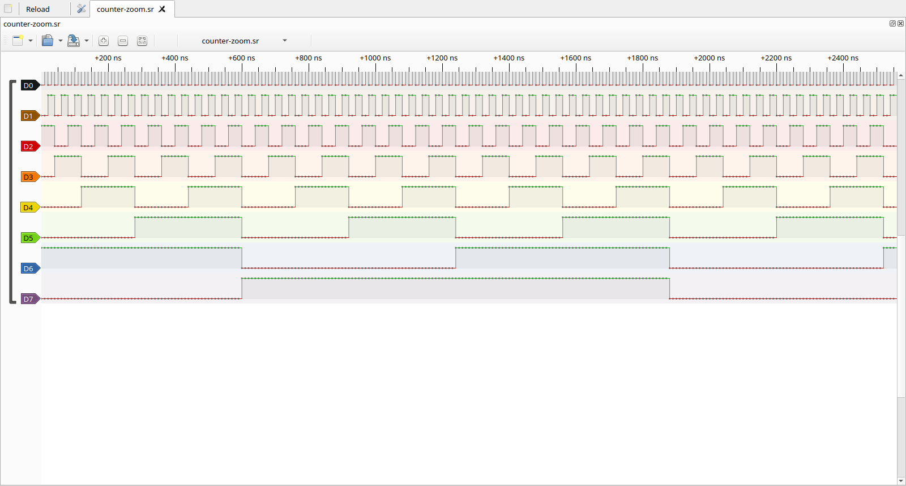

# PVLA — fabric logic analyzer over FT601

Vivado IP that samples 1–8 LVCMOS33 probes in the FPGA and streams them to **PulseView** (libsigrok). First PHY is the Alchitry **Ft+** FT601 SuperSpeed FIFO. This is not AMD ILA / Vivado Hardware Manager.

This tree is **PVLA / FT601 only**. NeoRV32, LOOM, and other projects are not in this snapshot. There is **no bitstream in this zip** — build one, then load **SRAM** (never QSPI).

## Unzip → Vivado Tcl → SRAM → D3XX (Au)

1. Unzip https://github.com/greg676/vivado_neorv32/archive/refs/tags/pvla.zip  
   GitHub names the folder `vivado_neorv32-pvla`.
2. Open a **Vivado Tcl shell** (`vivado -mode tcl`, or **Tools → Tcl Console** in the GUI).
3. `cd` into `platforms/alchitry-au-v2` inside that unzip. The script’s `./rtl` paths are relative to that directory. Part is **`xc7a35tftg256-1`** (do not use CSG324; do not load a Pt `xc7a100t` bit onto Au).

```tcl
cd platforms/alchitry-au-v2
source tcl/rebuild_la_capture.tcl
```

That writes `bitstreams/la_capture_top_v2.bit`. Confirm JTAG `idcode` `0x362d093` / xc7a35 **every** reload, then SRAM-load (never `--write-flash`, `.mcs`, or QSPI):

```bash
openFPGALoader --fpga-part xc7a35tftg256 --write-sram \
    bitstreams/la_capture_top_v2.bit
```

4. **D3XX host** (FTDI Linux D3XX SDK unpacked so `ftd3xx.h` and `libftd3xx.so` are on `D3XX_DIR`). Overlapped IN, not 16 KiB Python:

```bash
make -C host/ft601-loopback d3xx D3XX_DIR=$HOME/ft601-host/d3xx/unpack/linux-arm-v8
./host/ft601-loopback/ft601_loopback_d3xx --packed-counter --bytes 16777216 \
    --chunk-bytes 262144 --nflight 4
```

PulseView `.sr` (optional):

```bash
python3 host/ft601-capture/ft601_capture.py --backend d3xx \
    --bytes 16384 --chunk-bytes 4096 --sr /tmp/au-la.sr
pulseview -c -D -i /tmp/au-la.sr
```

Clone instead of zip (this snapshot only — a plain clone of `vivado_neorv32` is the SoC tree, not PVLA):

```bash
git clone --branch pvla --single-branch --depth 1 \
    https://github.com/greg676/vivado_neorv32.git pvla
cd pvla/platforms/alchitry-au-v2
```

Then the same Tcl `source` as above.

## Status (Au, live)

Alchitry **Au** `xc7a35t` + Ft+ V2. SRAM reload only. **No QSPI.** SuperSpeed `0403:601f` @ 5000M. Overlapped D3XX IN.

| Path | Rate | vs 381.47 MiB/s theoretical |
|---|---:|---:|
| Capture IN **sink** | **335 MiB/s** | 88% |
| Capture IN **verified** packed counter | **257 MiB/s** | 67% (`words_ok` consecutive, 0 bad) |
| TX-only sink (USB ceiling) | 335 MiB/s | 88% |

32-bit × 100 MHz `ft_clk` = 400 MB/s = **381.47 MiB/s**. Remaining verify-vs-sink gap is host memcpy, not the FPGA packer.



PulseView **0.4.2** / sigrok-cli **0.7.2** open the host `.sr`. Simulated LAT3 → `.sr` is under `platforms/alchitry-platinum-v2/host/pulseview-sim/`.

## Hardware sandwich (stock)

```
Ft+ FT601Q  → USB 3 host
        │  top connector
FPGA (Au xc7a35t  or  Pt V2 XC7A100T + DDR3)
        │  bottom connector
Br (or later LA input board)
```

Ft+ stays on top. Bottom is the instrument. **SRAM / RAM bitstream only** — never `--write-flash`, `.mcs`, or QSPI.

## Layout

| Path | What |
|---|---|
| [`ip/pvla/`](https://github.com/greg676/vivado_neorv32/tree/pvla/ip/pvla) | Catalog IP `greg676:user:pvla:1.0` (BD GUI, 1–8 channels, Ft+ XDC scoped to the IP) |
| [`platforms/alchitry-au-v2/`](https://github.com/greg676/vivado_neorv32/tree/pvla/platforms/alchitry-au-v2) | Proven Au PHY + 335 MiB/s capture |
| [`platforms/alchitry-platinum-v2/`](https://github.com/greg676/vivado_neorv32/tree/pvla/platforms/alchitry-platinum-v2) | Pt loopback, sampler, optional MIG7 256 MB buffer |
| [`host/`](https://github.com/greg676/vivado_neorv32/tree/pvla/platforms/alchitry-au-v2/host) | Canonical Au libusb/D3XX loopback + capture (symlink to the Au platform host) |

PVLA in Vivado: **Settings → IP → Repository →** `<unzip>/ip`, drop **PVLA**, 1–8 channels, `C_BOARD=AU_V2`.

## SRAM, not QSPI

Every Au and Pt LA load in this work is **RAM**: `openFPGALoader --write-sram` or Vivado `program_ram`. No `write_cfgmem`, no `.mcs`, no flash. Reload SRAM for each test.

## NeoRV32 is not in this tree

The RISC-V SoC stays private. LA / FT601 / PVLA tops **do not instantiate NeoRV32**. Pt DDR3 (`pvla_mig7_top`) is a fabric AXI master + MIG, no CPU in the BD.
